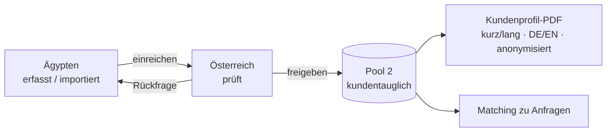

# Meridian Talent – Talent-System

Internes Werkzeug von Meridian Talent (Wien) zur einheitlichen Erfassung von Entwicklern, zur Qualitätssicherung im **Zwei-Phasen-Prozess** (Erfassung in Ägypten → Freigabe in Österreich), zur Erstellung von **Kundenprofil-PDFs** und zum **Matching** von Kundenanfragen.



**Stack:** Bun-Monorepo · Hono + Zod/OpenAPI · Drizzle + PostgreSQL 18 · Angular 22 (zoneless, Signals) + Tailwind 4 + Transloco · Playwright/Chromium (PDF) · S3/MinIO · Caddy · Docker Compose · GitHub Actions

## Schnellstart (Entwicklung)

Voraussetzungen: Docker (mit Compose v2), optional [Bun 1.4.4](https://bun.sh) für lokale Befehle.

```bash
bun install          # optional: lokale Abhängigkeiten, Git-Hooks
docker compose up    # startet Postgres, MinIO, Mailpit, API (Hot-Reload) und Web
```

Beim Start werden Migrationen ausgeführt und Demodaten angelegt (Skill-Katalog, 7 fiktive Entwickler, 3 Kunden mit Anfragen).

| Dienst             | URL                                                        |
| ------------------ | ---------------------------------------------------------- |
| Web-Oberfläche     | http://localhost:4200                                      |
| API / Health       | http://localhost:3000/api/health                           |
| API-Doku (Swagger) | http://localhost:3000/api/docs                             |
| Mailpit (E-Mails)  | http://localhost:8025                                      |
| MinIO-Konsole      | http://localhost:9001 (`meridian` / `meridian-dev-secret`) |

### Demo-Logins (nur Entwicklung)

| Rolle                | E-Mail                   | Passwort             |
| -------------------- | ------------------------ | -------------------- |
| Ägypten (Erfassung)  | `egypt@meridian.local`   | `Egypt-Demo-2026!`   |
| Österreich (Prüfung) | `austria@meridian.local` | `Austria-Demo-2026!` |
| Administration       | `admin@meridian.local`   | `Admin-Demo-2026!`   |

Die Passwörter kommen aus `docker-compose.yml` (`SEED_*`). In Produktion werden Nutzer nur mit Passwörtern aus der Umgebung bzw. per Einladungslink angelegt, Demodaten sind dort gesperrt.

## Befehle

| Befehl                                            | Zweck                                                                                                                 |
| ------------------------------------------------- | --------------------------------------------------------------------------------------------------------------------- |
| `bun run lint` / `bun run format:check`           | ESLint / Prettier (alle Workspaces)                                                                                   |
| `bun run typecheck`                               | TypeScript strict (alle Workspaces)                                                                                   |
| `bun run --filter '@meridian/shared' test`        | Unit-Tests Fachlogik (Policy, Zustandsautomat, Checkliste, Matching)                                                  |
| `bun run --filter '@meridian/api' test`           | API-Integrationstests (benötigt `docker compose up postgres`; PDF-Tests benötigen `bunx playwright install chromium`) |
| `bun run --filter '@meridian/web' test`           | Angular-Unit-Tests                                                                                                    |
| `bun run db:generate`                             | neue Drizzle-Migration aus dem Schema erzeugen                                                                        |
| `bun run db:migrate` / `bun run db:seed`          | Migrationen anwenden / Seed (mit `DATABASE_URL`)                                                                      |
| `bun run --filter '@meridian/api' jobs:retention` | Aufbewahrungsjob einmalig ausführen                                                                                   |
| `bun run e2e`                                     | Playwright-E2E gegen `E2E_BASE_URL` (Standard: `https://localhost`, siehe unten)                                      |

Lokales Node älter als 22.22.3? Dann Angular über Bun starten: `cd apps/web && bunx --bun ng build`.

## Produktion

```bash
cp .env.example deploy/.env      # ausfüllen (siehe docs/runbook.md)
docker compose -f deploy/docker-compose.prod.yml up -d
```

Caddy terminiert TLS automatisch (Let's Encrypt) und leitet `/api` an die API, alles andere an die SPA. Postgres ist nur im internen Netz erreichbar. Ein Backup-Container erstellt nächtlich verschlüsselte Dumps. Details: [docs/runbook.md](docs/runbook.md).

**E2E lokal gegen die Produktions-Images:**

```bash
docker build -f apps/api/Dockerfile --target runtime -t meridian-talent-api:ci .
docker build -f apps/web/Dockerfile --target runtime -t meridian-talent-web:ci .
cp deploy/e2e.env deploy/.env
docker compose -f deploy/docker-compose.prod.yml -f deploy/docker-compose.e2e.yml up -d --wait
cd apps/web && bunx playwright test
```

## Projektstruktur

```
apps/api        Hono-API (Module: auth, users, developers, skills, documents, clients,
                requests, pdf, imports, audit, settings, gdpr), Drizzle-Schema & Migrationen,
                PDF-Templates, Tests
apps/web        Angular-SPA (core, shared, features), i18n unter public/i18n, Playwright-E2E
packages/shared Zod-Schemas, Enums, Policy, Zustandsautomat, Checkliste, Matching, Marke
deploy          Caddyfile, Produktions-Compose, Backup/Restore, E2E-Override
docs            Architektur, Entscheidungen, Sicherheit, DSGVO, Runbook, Prototyp
```

## Dokumentation

- [Architektur](docs/architecture.md) – Komponenten, Zwei-Phasen-Prozess, Datenmodell, Tests
- [Entscheidungen](docs/decisions.md) – offene Punkte und gewählte Varianten
- [Sicherheit](docs/security.md) – STRIDE, Kontrollen, Checkliste
- [Datenschutz](docs/dsgvo.md) – Verarbeitungsübersicht, Löschkonzept, TOMs, KI-Import
- [Runbook](docs/runbook.md) – Deployment, Update, Rollback, Backup/Restore, Monitoring
- [Referenz-Prototyp](docs/reference/entwickler-system-prototyp.html)
