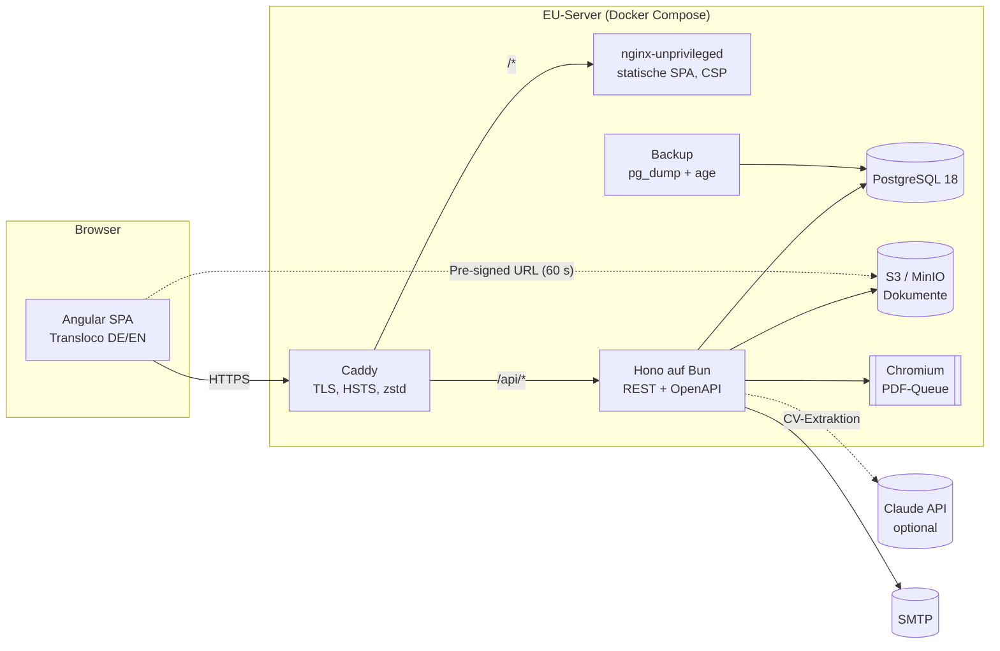
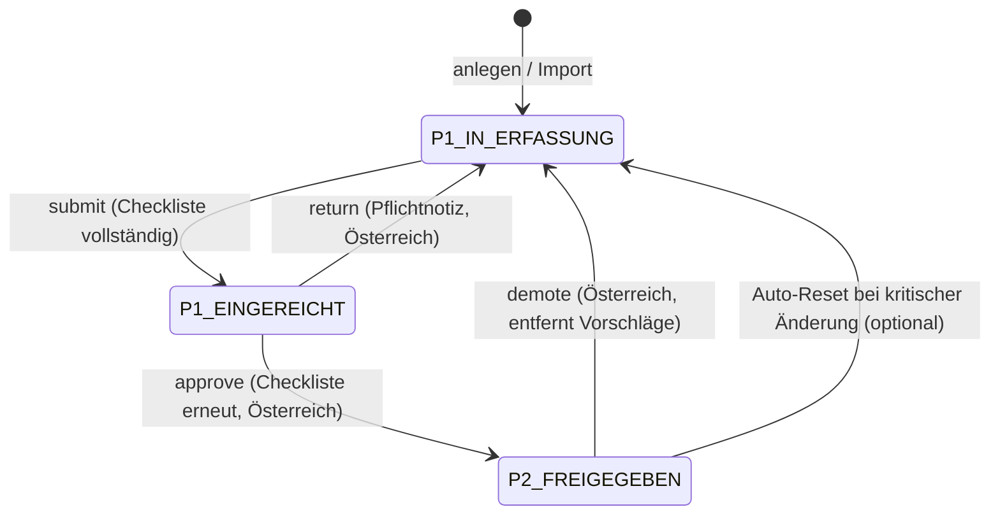
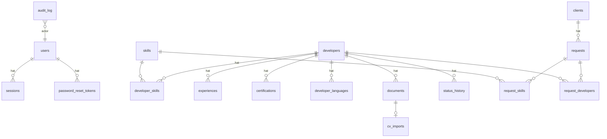

# Architektur

## Überblick

- **Monorepo** mit Bun-Workspaces: `apps/api`, `apps/web`, `packages/shared`.
- **`packages/shared`** ist der fachliche Kern ohne Seiteneffekte: Enums, Zod-Schemas (Validierung in API und Formularen, OpenAPI, Typen), zentrale **Policy** (`can()`), **Zustandsautomat**, **Checkliste**, **Matching**. Alles rein und separat getestet.
- **API** (`apps/api`): Hono + `@hono/zod-openapi`. Jede Route deklariert Request- und Response-Schemas. Daraus entstehen die Validierung, der einheitliche Fehler-Hook und `/api/openapi.json`. Abhängigkeiten (DB, Storage, Mail, PDF, KI, Virenscan, Rate-Limiter, Uhr) werden als `Deps` injiziert und sind in Tests ersetzbar.
- **Web** (`apps/web`): Angular 22, zoneless, Standalone Components, Signals, neue Control-Flow-Syntax, Lazy-Routes, Tailwind 4 + CDK (Dialoge), Transloco. Die UI blendet Aktionen per Policy aus, die API erzwingt sie.

## Zwei-Phasen-Prozess

Durchgesetzt in `developer.service.ts → transitionDeveloper()` innerhalb einer Transaktion mit `SELECT … FOR UPDATE`. Ablauf: Rollenrecht (403), gültiger Übergang (409 `INVALID_TRANSITION`), Einschränkung (403 `PROCESSING_RESTRICTED`), Pflichtnotiz (400), Checkliste (409 `CHECKLIST_INCOMPLETE`). Danach Statuswechsel, `status_history`, `audit_log`. Nur Pool 2 ist kundentauglich: PDF (`assertCan('pdf:generate')`), Matching (Query filtert `P2_FREIGEGEBEN`) und Vorschläge (`propose()` prüft) erzwingen das jeweils serverseitig.

## Berechtigungen

`packages/shared/src/policy.ts` enthält die Matrix Rolle → Aktion und die ressourcenabhängigen Regeln (Ägypten bearbeitet nur `P1_IN_ERFASSUNG`, PDF nur Pool 2, Einschränkung blockiert Änderungen). Die API nutzt `requirePermission()` auf Routenebene und `assertCan()` mit Ressourcenkontext. Das Frontend bekommt die Rechte über `/api/auth/me` und nutzt dieselbe Funktion. Es gibt keine verstreuten `role ===`-Abfragen.

## Datenmodell (vereinfacht)

UUIDv7-Primärschlüssel (`uuidv7()` aus Postgres 18), `created_at`/`updated_at` überall, Check-Constraints (Level 1–5, Jahre, Währung, `P2` erfordert `approved_at`), FK-Regeln (`cascade` für Profilinhalte, `restrict` für Skills und Kunden), Trigram-Index für die Suche. Soft-Delete gibt es für Entwickler, Kunden und Anfragen. Migrationen liegen versioniert unter `apps/api/drizzle/`; `0001` installiert den Append-only-Trigger.

## Wichtige Abläufe

| Ablauf          | Ort                                               | Hinweise                                                                                                           |
| --------------- | ------------------------------------------------- | ------------------------------------------------------------------------------------------------------------------ |
| Login/Session   | `modules/auth`                                    | Argon2id, Token nur als SHA-256-Hash, Rotation, Leerlauf- und absolute Ablaufzeit, Sperre nach Fehlversuchen, TOTP |
| Entwickler-CRUD | `modules/developers`                              | Gesamtes Aggregat per `PUT` mit `version`, Feld-Diff im Audit, Skill-Auflösung mit Alias-Normalisierung            |
| Dokumente       | `modules/documents`                               | Magic-Byte-Prüfung, Virenscan-Hook (ClamAV), zufällige Storage-Keys, Pre-signed URLs                               |
| Matching        | `packages/shared/matching.ts`, `modules/requests` | Reine Funktion; API lädt Pool-2-Profile und Skills in 2 Queries                                                    |
| PDF             | `templates/*`, `lib/pdf-renderer.ts`              | Selbstenthaltendes HTML (eingebettete Schrift), Chromium ohne JS/Netz, Queue mit Parallelitätslimit und Timeout    |
| CV-Import       | `modules/imports`                                 | Claude Structured Outputs (Schema aus Zod), Feature-Flag, Pflicht-Review pro Abschnitt                             |
| DSGVO           | `modules/gdpr`                                    | Export JSON/PDF, Löschung inkl. S3 und Audit-Schwärzung, Einschränkung, Aufbewahrungsjob (Advisory-Lock)           |

## Fehlerformat

Alle Fehler: `{ "code": "…", "message": "…", "details"?: …, "requestId": "…" }`. Die Codes sind in `packages/shared/src/schemas/common.ts` definiert und im Frontend unter `errors.<CODE>` in beiden Sprachen übersetzt (Test prüft Vollständigkeit). Die `X-Request-Id` steht in jeder Antwort und in jeder Logzeile.

## Tests

| Ebene  | Werkzeug                          | Umfang                                                                                                                                                                                                           |
| ------ | --------------------------------- | ---------------------------------------------------------------------------------------------------------------------------------------------------------------------------------------------------------------- |
| Shared | `bun test`                        | Zustandsautomat, Checkliste, Policy je Rolle, Matching inkl. Normalisierung                                                                                                                                      |
| API    | `bun test` + echte Postgres       | Auth (Sperre, Session, CSRF, Reset, TOTP), jede Regel aus Abschnitt 4/5, Dokumente, Matching, PDF mit echtem Chromium (Textextraktion prüft Anonymisierung), Import-Fehlerfälle, Extractor gegen Mock-API, DSGVO |
| Web    | Angular Unit-Test-Runner (Vitest) | Übersetzungsparität, Fehlercodes, Drafts, CSRF-Interceptor, UI-Policy                                                                                                                                            |
| E2E    | Playwright                        | 5 Szenarien gegen Produktions-Images hinter Caddy                                                                                                                                                                |

## Meilensteine

| #   | Inhalt                                                          | Stand                                      |
| --- | --------------------------------------------------------------- | ------------------------------------------ |
| 1   | Fundament (Monorepo, Lint, Env, Compose, Health, CI)            | ✅ `docker compose up` startet alles       |
| 2   | Datenbank, Auth, RBAC, Rate-Limit, CSRF, Audit                  | ✅ 27 Auth-Tests                           |
| 3   | Entwickler-Modul, Zustandsautomat, Dokumente                    | ✅ alle Regeln aus Abschnitt 4 getestet    |
| 4   | Frontend-Kern                                                   | ✅                                         |
| 5   | Kunden, Anfragen, Matching                                      | ✅                                         |
| 6   | PDF-Kundenprofil inkl. Sammel-PDF                               | ✅                                         |
| 7   | Lebenslauf-Import mit KI                                        | ✅                                         |
| 8   | Admin, DSGVO, Aufbewahrung, Audit-Ansicht                       | ✅                                         |
| 9   | Produktion (Caddy, Prod-Compose, Backup/Restore, Härtung, Doku) | ✅ Backup/Restore real getestet            |
| 10  | E2E, Last-Smoke, Audit, README, Release-Tag                     | ✅ (Images-Push erfolgt durch CI beim Tag) |
